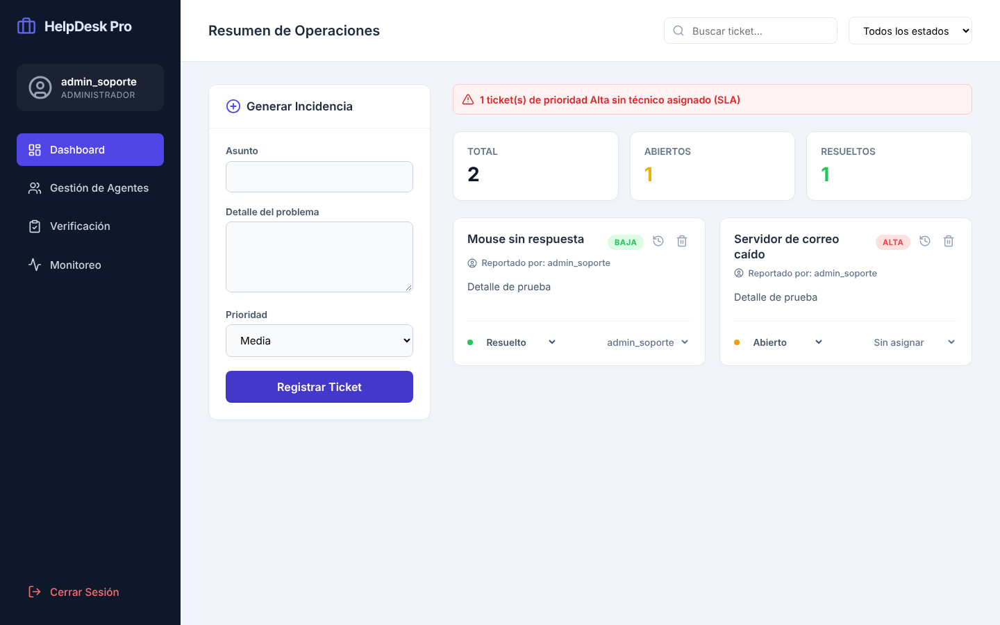
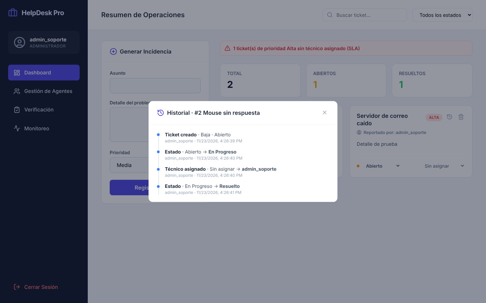
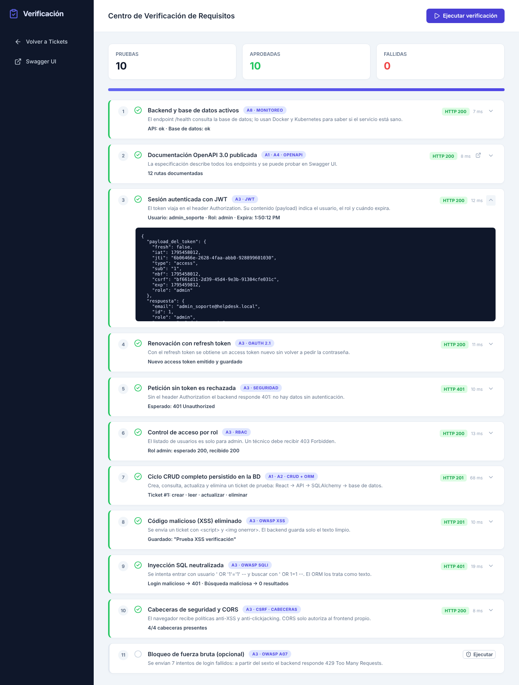

# HelpDesk Pro

## Sistema de Mesa de Ayuda y Tickets de Soporte IT

[](https://github.com/arsleck/Sistema-de-Mesa-de-Ayuda-y-Tickets-de-Soporte-IT-/actions/workflows/ci-cd.yml)

HelpDesk Pro es una plataforma web Full Stack para centralizar la gestión, seguimiento y atención de solicitudes e incidencias de soporte tecnológico en entornos corporativos y académicos.

Los usuarios registran tickets y consultan su estado; los técnicos y administradores gestionan estados, asignan responsables y supervisan el cumplimiento del **SLA**. El sistema aplica **RBAC** en el backend, autenticación **JWT (modelo OAuth 2.1)**, mitigaciones del **OWASP Top 10 2023**, y se despliega con **Docker**, **Kubernetes**, **GitHub Actions** y **Terraform**, con monitorización en **Prometheus + Grafana**.

> Proyecto de la asignatura **Ingeniería Web II**. El cumplimiento de cada actividad del curso está en [`docs/ANALISIS_REQUISITOS.md`](docs/ANALISIS_REQUISITOS.md) y las razones de cada herramienta en [`docs/adr/`](docs/adr/README.md).



---

# Índice de documentación

| Documento | Contenido | Actividad |
|---|---|---|
| [ANALISIS_REQUISITOS.md](docs/ANALISIS_REQUISITOS.md) | Estado inicial vs. final de cada requisito | Todas |
| [DEMO.md](docs/DEMO.md) | **Guion paso a paso para la sustentación** | Todas |
| [openapi.yaml](docs/openapi.yaml) · Swagger UI en `/api/docs` | Especificación OpenAPI 3.0 | A1, A4 |
| [postman/](docs/postman/) | Colección Postman con 26 peticiones y pruebas automáticas | A1, A4 |
| [PRUEBAS.md](docs/PRUEBAS.md) | pytest, Postman y Centro de verificación | A2, A4 |
| [seguridad/SEGURIDAD.md](docs/seguridad/SEGURIDAD.md) | JWT/OAuth 2.1 y OWASP con evidencia antes/después | A3 |
| [DOCKER_Y_MONITOREO.md](docs/DOCKER_Y_MONITOREO.md) | Dockerfiles, variables de entorno, Prometheus y Grafana | A5, A8 |
| [KUBERNETES_Y_CICD.md](docs/KUBERNETES_Y_CICD.md) | Minikube, HPA, GitFlow y pipeline CI/CD | A6, A7, A8 |
| [terraform/README.md](terraform/README.md) | Infraestructura como código en Azure (en inglés) | A7 |
| [adr/](docs/adr/README.md) | 11 decisiones de arquitectura justificadas | Todas |

---

# Características principales

## Gestión de usuarios
- Registro público (siempre con rol `employee`), inicio y cierre de sesión.
- El administrador crea técnicos desde el **Panel Admin**; el admin inicial se crea con variables de entorno.
- JWT de acceso (30 min) + refresh token (7 días) con **renovación automática** y **revocación en el logout**.

## Gestión de tickets
- Crear, consultar, filtrar y buscar tickets (asunto, detalle, prioridad, estado, creador, técnico asignado).
- Técnicos y administradores cambian el estado, asignan responsables y eliminan.
- El creador puede corregir su ticket mientras está **Abierto**.
- **Historial de cambios (auditoría):** quién cambió qué y cuándo, en una línea de tiempo.



## Dashboard y SLA
- Totales por estado para el staff y aviso de **tickets de prioridad Alta sin técnico asignado**.
- Tiempo promedio de resolución (`/api/tickets/stats`) y su histograma en Grafana.

## Centro de verificación
Página `/verificacion` (staff) que ejecuta en secuencia **11 pruebas en vivo** contra el backend real, una por requisito del curso, con código HTTP, tiempo y evidencia.



| Estado | Descripción | | Prioridad | Descripción |
|---|---|---|---|---|
| `Abierto` | Pendiente de atención | | `Baja` | Bajo impacto |
| `En Progreso` | En atención | | `Media` | Atención normal |
| `Resuelto` | Atención finalizada | | `Alta` | Atención prioritaria (SLA) |

---

# Roles y permisos (RBAC)

Los permisos se validan **en el backend** con el decorador `@roles_required` (`backend/app/utils/auth_helpers.py`).

| Funcionalidad | Employee | Agent | Admin |
|---|:---:|:---:|:---:|
| Registrarse / iniciar y cerrar sesión | Sí | Sí | Sí |
| Crear tickets | Sí | Sí | Sí |
| Consultar tickets | Solo propios | Todos | Todos |
| Editar asunto/detalle (mientras esté Abierto) | Propios | Sí | Sí |
| Cambiar estado / asignar técnico / eliminar | No | Sí | Sí |
| Ver historial | Propios | Todos | Todos |
| Centro de verificación y Monitoreo | No | Sí | Sí |
| Crear técnicos / listar usuarios | No | No | Sí |

---

# Arquitectura

```text
                         Navegador (React + Vite)
                                   │ HTTPS / JSON + JWT
                   ┌───────────────▼────────────────┐
                   │ Nginx (frontend)               │ sirve la SPA y reenvía /api
                   └───────────────┬────────────────┘
                                   │
                   ┌───────────────▼────────────────┐  /metrics   ┌────────────┐   ┌─────────┐
                   │ Flask API (Gunicorn) × N pods  │◄────────────│ Prometheus │──►│ Grafana │
                   │ JWT · RBAC · OWASP · SLA       │             └────────────┘   └─────────┘
                   └───────┬────────────────┬───────┘
                           │ SQLAlchemy     │ rate limit compartido
                   ┌───────▼──────┐  ┌──────▼──────┐
                   │ PostgreSQL   │  │ Redis       │
                   └──────────────┘  └─────────────┘
```

El mismo par de imágenes Docker se ejecuta en **Docker Compose** (local), **Kubernetes/Minikube** (HPA 2–6 réplicas) y **Azure Container Apps** (Terraform).

## Modelo de datos (PostgreSQL, base `mesa_ayuda_it`)

| Tabla | Campos principales |
|---|---|
| `users` | `id`, `username`, `email`, `password_hash` (bcrypt), `role` (`employee` / `agent` / `admin`) |
| `tickets` | `id`, `title`, `description`, `status`, `priority`, `created_at`, `created_by_id` → users, `assigned_to_id` → users |
| `ticket_history` | `id`, `ticket_id` → tickets, `user_id` → users, `field`, `old_value`, `new_value`, `created_at` |
| `token_blocklist` | `id`, `jti` (tokens revocados en el logout), `created_at` |

---

# API REST

Documentación interactiva en **`/api/docs`** (Swagger UI) y especificación en [`docs/openapi.yaml`](docs/openapi.yaml).

| Método | Ruta | Descripción |
|---|---|---|
| GET | `/health` | Estado de la API, la BD, el almacén del rate limit y el pod que respondió |
| GET | `/metrics` | Métricas para Prometheus |
| POST | `/api/auth/register` · `/login` · `/refresh` · `/logout` | Autenticación |
| GET | `/api/auth/me` · `/agents` · `/users` | Perfil, técnicos (staff) y usuarios (admin) |
| POST | `/api/auth/admin/register` | Crear técnico (admin) |
| GET · POST | `/api/tickets` | Listar (filtros `status`, `priority`, `q`) y crear |
| GET · PUT · DELETE | `/api/tickets/<id>` | Detalle, actualizar y eliminar |
| GET | `/api/tickets/<id>/history` | Historial de cambios |
| GET | `/api/tickets/stats` | Métricas del dashboard y SLA |

---

# Stack tecnológico

| Capa | Tecnologías |
|---|---|
| Frontend | React 19, Vite, React Router DOM, Axios (interceptores JWT), Lucide React, Nginx |
| Backend | Python, Flask, Flask-JWT-Extended, Flask-Limiter, Flask-CORS, bcrypt, nh3, Gunicorn |
| Datos | PostgreSQL, SQLAlchemy (ORM), Redis |
| Pruebas | pytest + pytest-html, Postman/Newman, Centro de verificación |
| DevOps | Docker, Docker Compose, Kubernetes (Minikube), GitHub Actions, GHCR, Terraform (Azure) |
| Observabilidad | Prometheus (métricas + alertas), Grafana (dashboard aprovisionado), logs JSON |

---

# Ejecución

## Opción 1 · Docker Compose (recomendada)
```powershell
docker compose up -d --build
```
| Servicio | URL |
|---|---|
| Aplicación | http://localhost:8080 (`admin_soporte` / `super_secreta_123`) |
| Swagger UI | http://localhost:8080/api/docs |
| Prometheus | http://localhost:9090 |
| Grafana | http://localhost:3000 (lectura sin login; edición con `admin` / `admin`) |

## Opción 2 · Kubernetes (Minikube)
```powershell
minikube start --driver=docker --cpus=2 --memory=3072
minikube addons enable metrics-server
.\k8s\deploy.ps1
.\k8s\port-forward.ps1      # App :8081 · Prometheus :9091 · Grafana :3001
```

## Opción 3 · Desarrollo local
```powershell
copy .env.example .env      # ajustar DATABASE_URL y claves

cd backend
python -m venv venv; venv\Scripts\activate
pip install -r requirements-dev.txt
python run.py               # http://127.0.0.1:5000

cd ..\frontend
npm install
npm run dev                 # http://localhost:5173
```

## Pruebas
```powershell
cd backend; pytest                                   # 31 pruebas + reporte HTML en backend/reports/
python security\evidencia_seguridad.py               # evidencia OWASP (con el backend encendido)
npx newman run docs\postman\HelpDesk_Pro.postman_collection.json
```

---

# Estructura del proyecto

```text
├── .github/workflows/ci-cd.yml   # Pipeline: test → build → deploy (kind y Azure)
├── backend/
│   ├── app/
│   │   ├── models/               # user, ticket, history (ORM)
│   │   ├── routes/               # auth, tickets, health, docs (Swagger)
│   │   ├── utils/auth_helpers.py # RBAC: @roles_required
│   │   ├── security.py           # rate limit, cabeceras, saneamiento XSS, lista negra JWT
│   │   ├── metrics.py            # /metrics, SLA y logs JSON
│   │   └── seed.py               # administrador inicial
│   ├── security/                 # evidencia OWASP y demo de SQL Injection
│   ├── tests/                    # pytest (integración, RBAC, seguridad, métricas, SLA)
│   └── Dockerfile
├── frontend/
│   ├── src/pages/                # Login, Register, Tickets, AdminPanel, Verificacion
│   ├── src/components/           # TicketHistory
│   ├── nginx.conf · Dockerfile
├── monitoring/                   # Prometheus (config + alertas) y Grafana (dashboard)
├── k8s/                          # Manifiestos de Kubernetes y scripts de despliegue
├── terraform/                    # Infraestructura en Azure (en inglés)
├── scripts/generar_carga.py      # Prueba de carga para la demo de escalabilidad
├── docs/                         # Documentación, ADR, evidencias e imágenes
└── docker-compose.yml
```

---

# Flujo de trabajo (GitFlow)

`feature/*` → Pull Request a `develop` (con CI en verde) → `release` → `main`. Los commits siguen *Conventional Commits* (`feat:`, `fix:`, `docs:`, `test:`, `ci:`).

# Trabajo futuro
- Notificaciones por correo/Slack (webhooks) al cambiar un ticket.
- Comentarios y archivos adjuntos en los tickets.
- Migraciones de esquema con Flask-Migrate (Alembic).
- Despliegue productivo en Azure activando `AZURE_DEPLOY` en el pipeline.
