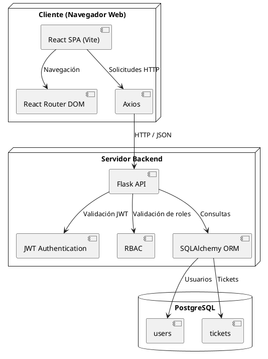

# HelpDesk Pro

## Sistema de Mesa de Ayuda y Tickets de Soporte IT

HelpDesk Pro es una plataforma web Full Stack desarrollada para centralizar la gestión, seguimiento y atención de solicitudes e incidencias de soporte tecnológico en entornos corporativos y académicos.

El sistema permite a los usuarios registrar solicitudes de soporte mediante tickets, consultar su estado y realizar seguimiento de los reportes generados. Los técnicos y administradores cuentan con permisos adicionales para gestionar el estado de las incidencias y asignar responsables para su resolución.

La plataforma implementa un esquema de **Control de Acceso Basado en Roles (RBAC)**, diferenciando las funcionalidades disponibles para empleados, técnicos y administradores. La comunicación entre el frontend y backend se realiza mediante una API REST utilizando JSON y autenticación mediante tokens JWT.

El proyecto utiliza **React y Vite** para el frontend, **Python y Flask** para el backend y **PostgreSQL con SQLAlchemy** para la persistencia de datos.

Actualmente, HelpDesk Pro se encuentra en desarrollo, con las funcionalidades principales de autenticación, gestión de tickets, asignación de responsables, prioridades, estados, filtros y dashboard implementadas. Se contempla ampliar el sistema en futuras versiones con notificaciones, webhooks, logging estructurado, comentarios, archivos adjuntos, estadísticas avanzadas y una administración visual más completa.

---

# Características principales

## Gestión de usuarios

- Registro de usuarios.
- Registro de técnicos.
- Inicio de sesión.
- Cierre de sesión.
- Autenticación mediante JWT.
- Control de acceso basado en roles.
- Diferenciación entre empleados, técnicos y administradores.
- El administrador se configura actualmente mediante un proceso no visual.
- Los usuarios no pueden eliminar sus cuentas desde la plataforma.

## Gestión de tickets

Los usuarios autenticados pueden crear y consultar tickets de soporte.

Cada ticket contiene:

- Asunto.
- Detalle del problema.
- Prioridad.
- Estado.
- Fecha de creación.
- Usuario que creó el ticket.
- Técnico asignado.

Los técnicos y administradores cuentan con permisos adicionales para:

- Consultar tickets.
- Cambiar el estado de las incidencias.
- Asignar o modificar el técnico responsable.

Actualmente los tickets no pueden editarse después de su creación.

## Estados de los tickets

El sistema contempla los siguientes estados:

| Estado | Descripción |
|---|---|
| `Abierto` | Ticket registrado y pendiente de atención. |
| `En Progreso` | La incidencia se encuentra siendo atendida. |
| `Resuelto` | La atención de la incidencia ha finalizado. |

## Prioridades

Los tickets pueden clasificarse según tres niveles de prioridad:

| Prioridad | Descripción |
|---|---|
| `Baja` | Incidencia de bajo impacto. |
| `Media` | Incidencia que requiere atención normal. |
| `Alta` | Incidencia que requiere atención prioritaria. |

## Filtrado

La plataforma permite filtrar los tickets para facilitar la consulta y seguimiento de las incidencias registradas.

## Dashboard

El sistema cuenta con un dashboard para visualizar información general relacionada con los tickets.

Actualmente esta sección se encuentra en proceso de ampliación y se contempla incorporar estadísticas adicionales en próximas versiones.

---

# Roles y permisos

HelpDesk Pro utiliza **RBAC (Role-Based Access Control)** para determinar las acciones que cada tipo de usuario puede realizar dentro de la plataforma.

| Funcionalidad | Employee | Agent | Admin |
|---|:---:|:---:|:---:|
| Registrarse | Sí | Según configuración | Según configuración |
| Iniciar sesión | Sí | Sí | Sí |
| Cerrar sesión | Sí | Sí | Sí |
| Crear tickets | Sí | Sí | Sí |
| Consultar tickets | Propios | Gestión de tickets | Gestión de tickets |
| Cambiar estado | No | Sí | Sí |
| Asignar técnico | No | Sí | Sí |
| Filtrar tickets | Sí | Sí | Sí |
| Dashboard | Sí | Sí | Sí |
| Gestión administrativa | No | No | Parcial |

Los permisos se validan en el backend de acuerdo con el rol asociado a cada usuario.

---

# Arquitectura del sistema

El proyecto utiliza una arquitectura desacoplada basada en una aplicación web frontend y una API REST backend.

```text
┌──────────────────────────────────────┐
│          Cliente / Navegador         │
│                                      │
│          React + Vite                │
│          React Router DOM            │
│          Axios                       │
└──────────────────┬───────────────────┘
                   │
                   │ HTTP / JSON
                   │ JWT
                   ▼
┌──────────────────────────────────────┐
│           Backend Flask              │
│                                      │
│          API REST                    │
│          JWT Authentication          │
│          RBAC                        │
│          SQLAlchemy                  │
└──────────────────┬───────────────────┘
                   │
                   │ SQL
                   ▼
┌──────────────────────────────────────┐
│             PostgreSQL               │
│                                      │
│             users                    │
│             tickets                  │
└──────────────────────────────────────┘
```

### Flujo de comunicación

1. El usuario interactúa con la aplicación React.
2. React realiza solicitudes HTTP mediante Axios.
3. Las solicitudes protegidas incluyen el token JWT.
4. Flask recibe y valida las solicitudes.
5. El backend verifica la autenticación y los permisos correspondientes.
6. SQLAlchemy gestiona las operaciones sobre PostgreSQL.
7. El backend devuelve la información al frontend mediante respuestas JSON.

---

# Diagrama de componentes

El siguiente diagrama puede generarse utilizando PlantUML:



---

# Modelo de datos

Actualmente el sistema utiliza PostgreSQL como sistema gestor de base de datos y SQLAlchemy como ORM.

La base de datos principal se denomina:

```text
mesa_ayuda_it
```

## Tabla `users`

Almacena la información de los usuarios registrados.

| Campo | Tipo | Descripción |
|---|---|---|
| `id` | Integer | Identificador único |
| `username` | String | Nombre de usuario |
| `email` | String | Correo electrónico |
| `password_hash` | String | Contraseña almacenada mediante hash |
| `role` | String | Rol del usuario |

Los roles disponibles son:

```text
employee
agent
admin
```

## Tabla `tickets`

Almacena las solicitudes de soporte.

| Campo | Tipo | Descripción |
|---|---|---|
| `id` | Integer | Identificador del ticket |
| `title` | String | Asunto del ticket |
| `description` | Text | Detalle del problema |
| `status` | String | Estado actual |
| `priority` | String | Prioridad |
| `created_at` | DateTime | Fecha de creación |
| `created_by_id` | Integer | Usuario que creó el ticket |
| `assigned_to_id` | Integer | Técnico asignado |

### Relaciones

La tabla `tickets` mantiene dos relaciones con `users`:

```text
users
  │
  ├── created_by_id ──> tickets
  │
  └── assigned_to_id ─> tickets
```

Esto permite identificar tanto al usuario que creó la incidencia como al técnico responsable de atenderla.

---

# Estructura del proyecto

```text
Sistema-de-Mesa-de-Ayuda-y-Tickets-de-Soporte-IT/
│
├── backend/
│   │
│   ├── app/
│   │   ├── models/
│   │   │   ├── ticket.py       # Modelo de tickets
│   │   │   └── user.py         # Modelo de usuarios
│   │   │
│   │   ├── routes/
│   │   │   ├── auth.py         # Autenticación y usuarios
│   │   │   ├── health.py       # Monitoreo del servicio
│   │   │   ├── tickets.py      # Endpoints de tickets
│   │   │   └── __init__.py
│   │   │
│   │   └── __init__.py         # Configuración de Flask
│   │
│   ├── .venv/                  # Entorno virtual
│   ├── venv/                   # Entorno virtual
│   ├── requirements.txt        # Dependencias Python
│   ├── run.py                  # Punto de entrada del backend
│   └── test_api.py             # Pruebas de la API
│
├── docs/
│   └── openapi.yaml             # Documentación OpenAPI
│
├── frontend/
│   │
│   ├── public/                  # Archivos públicos
│   │
│   ├── src/
│   │   ├── api/
│   │   │   └──                 # Configuración de Axios y JWT
│   │   │
│   │   ├── assets/              # Recursos gráficos
│   │   │
│   │   ├── pages/
│   │   │   ├──                 # Vistas de la aplicación
│   │   │   └──                 # Login, registro, tickets, etc.
│   │   │
│   │   ├── App.css              # Estilos principales
│   │   ├── App.jsx              # Componente principal
│   │   ├── index.css            # Estilos globales
│   │   └── main.jsx             # Punto de entrada de React
│   │
│   ├── .gitignore
│   ├── eslint.config.js
│   ├── index.html
│   ├── package.json              # Dependencias y scripts
│   └── vite.config.js
│
└── README.md
```

> Las carpetas `venv`, `.venv` y `node_modules` corresponden a dependencias y entornos locales y no deben incluirse en el repositorio de código fuente.

---

# Stack tecnológico

## Frontend

| Tecnología | Uso |
|---|---|
| React | Construcción de la interfaz |
| Vite | Herramienta de desarrollo y compilación |
| React Router DOM | Enrutamiento de la aplicación |
| Axios | Comunicación con la API |
| Lucide React | Iconografía |

## Backend

| Tecnología | Uso |
|---|---|
| Python | Lenguaje de programación |
| Flask | Framework para la API REST |
| Flask-JWT-Extended | Autenticación mediante JWT |
| Flask-CORS | Comunicación entre frontend y backend |
| Bcrypt | Protección de contraseñas |
| SQLAlchemy | ORM para PostgreSQL |

## Base de datos

| Tecnología | Uso |
|---|---|
| PostgreSQL | Sistema gestor de base de datos |
| SQLAlchemy | Mapeo objeto-relacional |

## Documentación

| Tecnología | Uso |
|---|---|
| OpenAPI | Documentación de la API REST |
| PlantUML | Diagramas de arquitectura |

---

# API REST

El backend expone una API REST para permitir la comunicación entre el frontend y los servicios del sistema.

## Health Check

### GET `/health`

Permite verificar el estado del servidor.

Respuesta esperada:

```json
{
  "status": "ok"
}
```

## Autenticación

Las rutas de autenticación se encuentran bajo:

```text
/api/auth
```

Entre las operaciones principales se encuentra el registro e inicio de sesión de usuarios.

## Tickets

Las rutas relacionadas con los tickets se encuentran bajo:

```text
/api/tickets
```

Las operaciones disponibles permiten consultar y gestionar las incidencias de soporte de acuerdo con los permisos del usuario autenticado.

> La documentación OpenAPI del proyecto se encuentra actualmente en `docs/openapi.yaml` y continuará ampliándose conforme se incorporen y documenten nuevos endpoints.

---

# Documentación OpenAPI

El proyecto incluye una primera versión de la especificación OpenAPI:

```text
docs/openapi.yaml
```

Actualmente documenta el monitoreo del servicio y parte de las operaciones relacionadas con tickets.

La documentación será ampliada en futuras versiones para incluir todos los endpoints de autenticación, usuarios y tickets, junto con sus parámetros, esquemas de respuesta, códigos HTTP y mecanismos de autenticación.

---

# Instalación

## Requisitos previos

Para ejecutar el proyecto localmente se requiere:

- Python 3.x
- Node.js
- npm
- PostgreSQL
- Git

---

# Configuración de la base de datos

Crear una base de datos PostgreSQL denominada:

```sql
CREATE DATABASE mesa_ayuda_it;
```

El backend utiliza PostgreSQL como sistema gestor de base de datos.

Antes de iniciar la aplicación, debe configurarse correctamente la conexión a PostgreSQL en el backend.

La aplicación utiliza SQLAlchemy para crear y gestionar las tablas correspondientes.

---

# Ejecución del Backend

Ingresar a la carpeta:

```bash
cd backend
```

Crear un entorno virtual:

```bash
python -m venv venv
```

### Windows

```powershell
venv\Scripts\activate
```

### Linux / macOS

```bash
source venv/bin/activate
```

Instalar las dependencias:

```bash
pip install -r requirements.txt
```

Ejecutar el servidor:

```bash
python run.py
```

El backend estará disponible en:

```text
http://127.0.0.1:5000
```

---

# Ejecución del Frontend

Abrir una nueva terminal y acceder a:

```bash
cd frontend
```

Instalar las dependencias:

```bash
npm install
```

Ejecutar el servidor de desarrollo:

```bash
npm run dev
```

El frontend estará disponible normalmente en:

```text
http://localhost:5173
```

---

# Pruebas

El backend incluye un archivo destinado a las pruebas de la API:

```text
backend/test_api.py
```

Este archivo permite realizar verificaciones sobre el funcionamiento de los servicios disponibles en el backend.

Las pruebas pueden ampliarse para cubrir:

- Registro de usuarios.
- Inicio de sesión.
- Autenticación JWT.
- Creación de tickets.
- Consulta de tickets.
- Actualización de estados.
- Asignación de técnicos.
- Control de permisos.
- Respuestas de la API.

---

# Seguridad

El sistema incorpora diferentes mecanismos relacionados con la seguridad:

- Autenticación mediante JWT.
- Control de acceso basado en roles.
- Hashing de contraseñas mediante Bcrypt.
- Protección de endpoints.
- Separación de responsabilidades entre frontend y backend.
- Validación de permisos según el rol del usuario.

Para una versión de producción se recomienda trasladar las credenciales de conexión a PostgreSQL y las claves utilizadas para JWT a variables de entorno.

---

# Funcionalidades pendientes

El proyecto continúa en desarrollo. Las siguientes características están contempladas para próximas versiones:

## Administración

- Panel administrativo visual.
- Gestión visual de administradores y técnicos.
- Administración más completa de usuarios.
- Gestión de permisos desde la interfaz.

## Gestión de tickets

- Edición de tickets.
- Historial de cambios.
- Comentarios dentro de los tickets.
- Archivos adjuntos.
- Mayor personalización de categorías y prioridades.

## Notificaciones

- Sistema de notificaciones para cambios en los tickets.
- Integración mediante webhooks.
- Notificaciones por correo electrónico.
- Integración con Slack.

## Dashboard

- Estadísticas avanzadas.
- Cantidad de tickets por estado.
- Cantidad de tickets por prioridad.
- Tickets por técnico.
- Tiempo promedio de resolución.
- Indicadores de rendimiento del servicio.

## Observabilidad

- Logging estructurado de incidencias.
- Registro de eventos importantes.
- Seguimiento de errores del backend.
- Auditoría de acciones administrativas.

## Documentación

- Completar la especificación OpenAPI.
- Documentar todos los endpoints.
- Incorporar ejemplos de solicitudes y respuestas.
- Documentar códigos de error y respuestas de autenticación.

---

# Roadmap

La evolución prevista del proyecto puede organizarse de la siguiente manera:

```text
Versión 1.0
│
├── Autenticación
├── RBAC
├── Gestión de tickets
├── Estados
├── Prioridades
├── Asignación de técnicos
├── Filtros
└── Dashboard inicial
        │
        ▼
Versión 1.1
│
├── Dashboard avanzado
├── Edición de tickets
├── Comentarios
└── Archivos adjuntos
        │
        ▼
Versión 1.2
│
├── Notificaciones
├── Webhooks
├── Correo electrónico
└── Integración con Slack
        │
        ▼
Versión 2.0
│
├── Logging estructurado
├── Auditoría
├── Estadísticas avanzadas
├── Administración visual
└── Documentación API completa
```

---

# Información académica

**Proyecto:** HelpDesk Pro — Sistema de Mesa de Ayuda y Tickets de Soporte IT

**Institución:** Universidad Manuela Beltrán

**Programa:** Ingeniería de Software

**Asignatura:** Ingeniería Web 2

**Semestre:** Sexto semestre

**Año:** 2026

---

# Integrantes

### Diego Nicolas Cuervo Ochoa

### Andres Felipe Murcia Fuentes

---

# Estado del proyecto

**Estado actual:** En desarrollo.

HelpDesk Pro cuenta actualmente con una base funcional para la gestión de solicitudes de soporte IT, incluyendo autenticación, control de acceso por roles, creación y consulta de tickets, asignación de técnicos, gestión de estados y prioridades, filtros y un dashboard inicial.

El proyecto se encuentra en proceso de evolución hacia una plataforma de mesa de ayuda más completa, incorporando progresivamente funcionalidades de notificación, observabilidad, administración, colaboración y análisis de información.

---

# Licencia

Este proyecto fue desarrollado con fines académicos para la Universidad Manuela Beltrán.

© 2026 — HelpDesk Pro