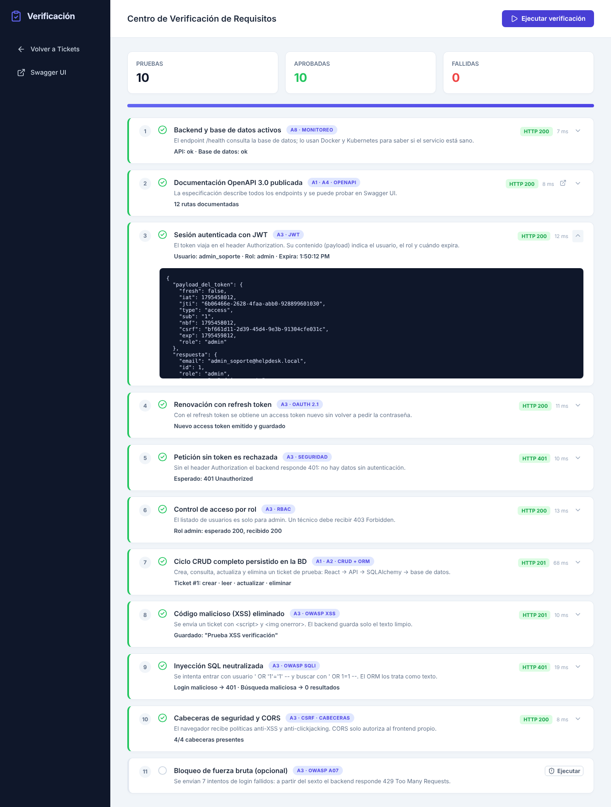

# Pruebas – HelpDesk Pro (Actividades 2 y 4)

El proyecto tiene **tres niveles de pruebas**, cada uno pensado para mostrarse en la sustentación:

| Nivel | Herramienta | Qué valida | Resultado |
|---|---|---|---|
| Integración (automáticas) | `pytest` + `pytest-html` | Flujo completo HTTP → Flask → JWT/RBAC → SQLAlchemy → BD | **25/25** ✅ |
| API (colección) | Postman / Newman | Cada endpoint, códigos HTTP y reglas RBAC | **25 peticiones, 32 tests** ✅ |
| Visual (navegador) | Centro de verificación (`/verificacion`) | Cada requisito del curso, en secuencia y con evidencia | **10/10 + fuerza bruta** ✅ |

## 1. Pruebas de integración con pytest

Usan una base de datos **SQLite en memoria**: no tocan PostgreSQL y cada prueba arranca limpia.

```powershell
cd backend
venv\Scripts\activate
pip install -r requirements-dev.txt
pytest
```

Se genera el reporte gráfico **`backend/reports/reporte_pruebas.html`** (ábrelo con doble clic).

| Archivo | Pruebas destacadas |
|---|---|
| `tests/test_integracion_api.py` | health + BD, Swagger, registro forzado a `employee`, login con access/refresh token, **ciclo de vida completo de un ticket** (crear → asignar → resolver → consultar → eliminar), filtros, métricas, validaciones |
| `tests/test_rbac_seguridad.py` | empleado solo ve lo suyo, no cambia estado ni elimina, solo admin crea técnicos, SQLi en login y búsqueda, XSS eliminado, CORS, cabeceras, refresh, logout revoca token, fuerza bruta → 429, bcrypt |

## 2. Colección Postman

`docs/postman/HelpDesk_Pro.postman_collection.json` → Postman → **Import** → **Run collection**.

También por consola: `npx newman run docs/postman/HelpDesk_Pro.postman_collection.json`

## 3. Centro de verificación (demostración visual)

1. Levantar backend (`python run.py`) y frontend (`npm run dev`).
2. Iniciar sesión como **admin** o **técnico**.
3. Menú lateral → **Verificación** → **Ejecutar verificación**.

Cada paso muestra el requisito del curso que demuestra, el código HTTP, el tiempo de respuesta y la evidencia (flecha ⌄).


